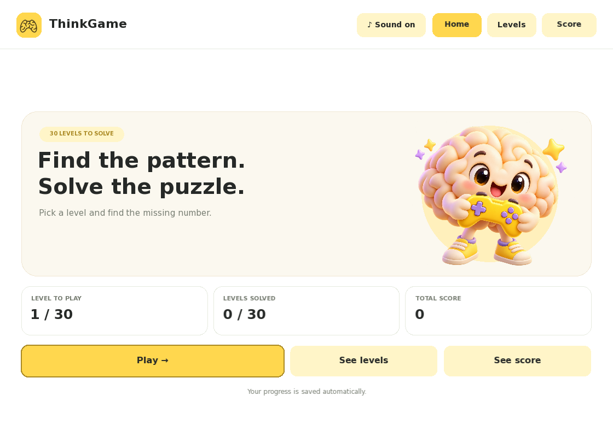
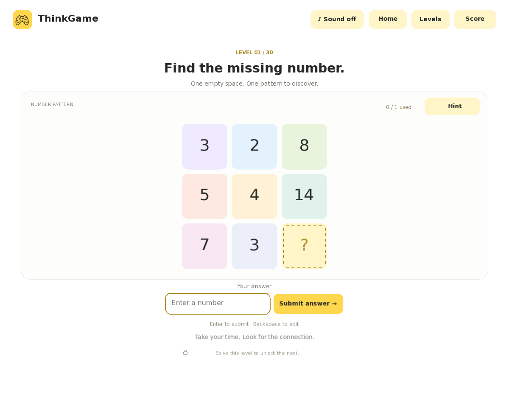

# ThinkGame

A complete offline C++17 / SFML 3 desktop game with 30 authored number-pattern puzzles. Solve each level to unlock the next, discover patterns across five geometric layouts, and track your progress in a white, pastel and yellow interface.

## Screenshots

**Home**



**Number-pattern puzzle**



## Quick start

Install the prerequisites listed under **Build from source**, then clone, build and play:

```bash
git clone https://github.com/aqsaaminmemon/ThinkGame.git
cd ThinkGame
cmake -S . -B build -DCMAKE_BUILD_TYPE=Release
cmake --build build -j 4
./run.sh
```

A graphical desktop session is required. The repository contains source code and assets; build the game locally before launching it. See below for Windows and macOS build notes.

## Controls

- The game opens on **Home**. Choose **Play** or **Continue playing** to enter the next unsolved puzzle, **See levels** to choose an unlocked level, or **See score** to review your progress.
- **Home**, **Levels**, and **Score** are always available in the top bar. Each completed level earns 100 points, up to 3,000; replaying a solved level does not award extra points. Existing saves automatically show the score for their completed levels.
- Type the missing whole number, use Backspace to edit, and press Enter or click **Submit answer**.
- **Hint** opens pattern help in plain words. Levels **1–10** allow one clue, **11–20** allow two, and **21–30** allow three. **Next hint** unlocks the next, more specific clue. Each unlock is saved immediately. **View hint / View hints** reopens the clues already unlocked without granting extra clues. Pattern help stays open until you close it with **×**, press Escape, select a different level, or solve the puzzle. There is no countdown.
- **Sound on / Sound off** in the top bar controls gentle pops and chimes for clicks, starting play, opening hints, correct answers, incorrect answers, and completing all levels. Muting immediately stops any playing effect. Sound starts enabled when the game is launched.
- Click **Levels** for the connected level map. The puzzle uses the full central content area, with larger shapes and numbers.
- Yellow nodes are completed; black-and-white nodes are unsolved. Locked nodes explain which previous level is required.
- After solving, read the worked explanation and click **Next level**.
- Tab / Shift+Tab move between controls, Enter activates the focused control, and Escape closes pattern help, dismisses a lock popup, returns from Levels, or goes Home.
- Scroll with the mouse wheel if a solution extends below a shorter window. The default window is 1120 × 800 and the minimum is 720 × 600. Puzzle graphics grow with the available space, and the whole interface scales up on larger windows.
- Use `./run.sh --puzzle` to start directly in the game, or `./run.sh --levels` to start on the level map.

There is exactly one missing number in each puzzle. Three examples form one puzzle: two completed examples establish the relationship, and the result in the third is hidden. Square, rectangle, hexagon, star and circle layouts each appear six times.

## Build from source

Requirements: a C++17 compiler, CMake 3.28+, Git, and SFML 3 or the system libraries needed to build it. CMake uses an installed SFML 3 when available; otherwise it fetches the pinned official SFML 3.0.2 source. This first configure may need internet access; the finished game runs offline.

Ubuntu / Debian build dependencies:

```bash
sudo apt install build-essential cmake git libx11-dev libxrandr-dev libxcursor-dev libxi-dev libudev-dev libfreetype-dev libflac-dev libvorbis-dev libgl-dev libegl-dev
cmake -S . -B build -DCMAKE_BUILD_TYPE=Release
cmake --build build -j 4
./build/thinkgame
```

SFML build reference: https://www.sfml-dev.org/tutorials/3.0/getting-started/cmake/

If the audio codec development packages are unavailable, configure with `-DSFML_USE_SYSTEM_DEPS=OFF` to fetch SFML's pinned bundled dependencies. The retained local build uses this option and includes audio.

On Windows use Visual Studio's C++ tools and CMake, or another supported C++17 toolchain. Build the `thinkgame` target and keep the copied `assets` folder beside the executable. On macOS install the compiler and CMake, then use the same configure/build commands. Windows and macOS builds have not been verified in this delivery.

`run.sh` prefers the local `build/thinkgame`, falling back to `bin/thinkgame` if a packaged executable is present.

To install into a directory of your choice:

```bash
cmake --install build --prefix "$HOME/.local"
```

The installed executable finds its bundled assets when launched by full path, through PATH, or through a symbolic link. Add the installation's `bin` directory to PATH to launch it as `thinkgame`.

## Saved progress

The versioned save contains the number of consecutively completed levels, current level and all 30 hint quotas. The unlock state is derived from consecutive completion rather than trusting a separate flag.

- Linux: `$XDG_DATA_HOME/thinkgame/progress.save`, or `~/.local/share/thinkgame/progress.save`.
- Windows: `%LOCALAPPDATA%/ThinkGame/progress.save`.
- macOS: `~/Library/Application Support/ThinkGame/progress.save`.

Writes use a temporary file, a backup of the previous valid save, and an atomic replacement. A checksum detects accidental corruption; it is not intended as an anti-cheat system. If the main save is damaged, the backup is loaded. A damaged save without a valid backup starts at Level 1 with a notice. Save failures keep the game playable and display an error.

Unlocked clues stay saved across reopening. Older saves with up to three recorded hint views remain readable; the displayed allowance is capped to the current level's tier. Reopening already unlocked clues does not reset the allowance. Levels and puzzles do not regenerate on retry or restart.

## Tests and catalogue

```bash
ctest --test-dir build --output-on-failure
```

For core tests without graphics dependencies:

```bash
cmake -S . -B build-core -DTHINKGAME_BUILD_APP=OFF
cmake --build build-core -j 4
ctest --test-dir build-core --output-on-failure
```

Optional real SFML rendering and event tests require a graphical display:

```bash
cmake -S . -B build -DTHINKGAME_BUILD_UI_TESTS=ON
cmake --build build -j 4
ctest --test-dir build --output-on-failure
```

The UI test writes screenshots in the temporary directory `thinkgame-ui-tests/screens`. It uses its own save, without changing player progress.

The full authored rule catalogue and worked answers are in `docs/level-catalogue.md`. Regenerate it with:

```bash
./build/thinkgame_catalogue > docs/level-catalogue.md
```

The catalogue contains spoilers. Difficulty is an authored progression across increasingly varied operations and relationships; different players may find particular rules easier or harder. Testing proves arithmetic and game behavior, not a psychometrically calibrated difficulty curve or unique answers under every conceivable mathematical rule.

## Project structure

- `src/puzzle.cpp`: all 30 authored puzzles, rules and catalogue validation.
- `src/game.cpp`: input, answer checking, progression and saved tiered clue allowances.
- `src/progress.cpp`: validated versioned saves, backups and corruption recovery.
- `src/ui.cpp`: SFML layout, five shape renderers, controls and level-map popup.
- `src/audio.cpp`: bundled sound effects and immediate mute control.
- `src/main.cpp`: window events, asset discovery and application entry point.
- `tests/`: core behavior and optional actual graphical event checks.
- `assets/`: supplied logo, generated home mascot, bundled fonts, original synthesized sound effects and third-party notices.

The original logo image is preserved. A rendering shader presents it in the approved charcoal-on-yellow badge, with the original image as a fallback on hardware without shader support. SFML is distributed under its included zlib/png license, and DejaVu font licensing is in `assets/FONT-LICENSE.txt`.
